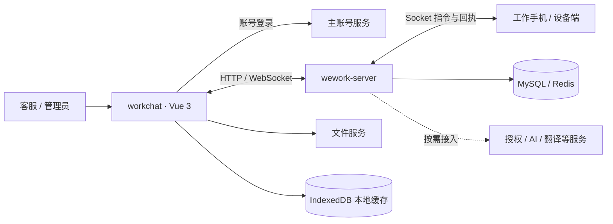

# workchat · 企业微信私域管理与工作手机客服系统

**将客户会话、企业通讯录、标签、群发、朋友圈、客服工具和设备管理集中到一个工作台。**

`workchat` 是客徕徕项目体系中的企业微信前端，面向客服团队、私域运营团队和需要自建工作手机管理系统的开发者。基于 Vue 3，提供 Web 界面、Electron 桌面工程及移动端适配页面，与 [wework-server](https://github.com/icodingany/wework-server) 配合使用。

**技术支持 / 合作：微信（WeChat）`Linglanhuakaiyue`**

**联系页面：[https://kelailai.chat/contact-us.html](https://kelailai.chat/contact-us.html)**

[在线体验](#在线体验) · [功能全览](#功能全览) · [项目优势](#项目优势) · [快速开始](#快速开始) · [整体架构](#整体架构) · [联系方式](#联系方式)

## 在线体验

打开测试环境：**https://test.kelailai.chat/**

| 账号 | 密码 |
| --- | --- |
| `test7` | `t123456` |

以上是维护者明确提供的公开测试账号，仅用于测试站体验，不是源码的默认账号，也不是生产凭据。请使用模拟数据；界面入口、设备在线状态和可操作功能以测试环境及账号权限为准。

本地源码默认连接本机服务，**不会自动使用测试站或生产站作为后端**。测试站是整体产品的体验入口，可能包含其他关联项目的能力；本仓库的实际范围以以下功能说明和代码为准。

## 项目定位

工作手机负责设备端执行，后端负责账号、权限、消息、任务和持久化，前端负责客服操作与业务展示。团队可以在一个界面中切换企微账号、处理客户会话、维护标签与话术，并按权限进入管理端。

适合以下场景：

- **客服协作**：集中处理多个企微账号的客户和群聊，查看历史、备注、标签和操作员信息。
- **私域运营**：复用素材与话术，安排消息和朋友圈任务，管理新好友回复及客户分组。
- **工作手机管理**：查看设备状态、账号分配、诊断日志和任务执行情况。
- **二次开发与私有化集成**：在自己的环境中对接身份系统、业务后端、文件服务及设备协议。

## 功能全览

下表列出当前仓库已有的页面、交互和协议接线。设备执行、消息回执、服务端查询与权限校验需要配套后端和在线设备；页面入口不代表所有外部依赖已随仓库提供。

### 1. 聚合聊天与客服工作台

- 多企微账号切换、在线状态展示、当前账号的会话与未读信息。
- 会话列表、客户列表、企业通讯录与部门联系人视图。
- 三栏工作台：左侧会话/联系人，中间消息与输入区，右侧资料、群信息和快捷回复。
- 私聊、群聊、历史消息查询与翻页，HTTP 历史快照与 WebSocket 实时通知协同。
- 文本、表情、图片、语音、视频、文件、链接、名片、小程序及视频号等消息形态的展示或发送接线，具体支持取决于消息类型和设备协议。
- 引用、转发、图片大图预览、文件下载、发送状态、失败重发与撤回相关处理。
- 展示发送操作员信息，便于在协作场景下区分消息来源。
- 公共快捷语、个人快捷语、收藏内容及素材选择入口。

代码入口：[conversation](src/views/conversation)、[消息处理](src/websocket)、[会话状态](src/store/modules/conversation.js)。

### 2. 客户、通讯录与群管理

- 好友与客户信息查看、备注、标签及群成员资料。
- 企业通讯录、部门与客户列表同步。
- 标签维护、批量打标签，以及按客户或群对象组织运营动作。
- 新客户列表、二维码导出、单向好友检测和“僵尸粉”标签补齐。
- 手机号码搜索添加、从微信好友添加、批量加好友及任务日志入口。
- 创建群与群相关操作、自动拉群开关。

“清理僵尸粉”页面当前侧重**检测、展示和补齐标签**，并非自动删除所有单向好友。

代码入口：[addFriend](src/views/addFriend)、[客户工具](src/views/tools/components)、[群资料](src/views/conversation/components/thirdPart/RoomInfo.vue)。

### 3. 群发、定时任务与朋友圈

- 群发对象选择、内容配置、发送任务和执行日志。
- 定时发消息、任务详情及执行状态查看。
- 朋友圈文本、图片、视频、链接的编辑与发布接线。
- 我的朋友圈、发布记录，以及点赞、评论等相关操作入口。
- 管理端定时发圈与素材资源库。

任务由后端调度、设备端执行。部分朋友圈扩展字段仍是预留项，详见 [功能边界](#功能边界)。

代码入口：[groupSend](src/views/groupSend)、[friendCircle](src/views/friendCircle)、[定时消息](src/views/admin/components/ScheduledMassMessage.vue)、[定时发圈](src/views/admin/components/ScheduledMoments.vue)。

### 4. 自动回复、话术与素材

- 关键词自动回复及内容编辑。
- 新增好友回复配置。
- 部门公共术语、个人快捷语与分类维护。
- 文本、图片、链接、视频等素材管理，并在会话、群发、朋友圈中复用。
- 快捷回复内容的导入导出辅助能力。

配套 `wework-server` 另含 AI 回复、LLM 配置及待人工处理接口。本前端当前不把这些后端能力描述为已经具备完整独立的 AI 管理控制台。

代码入口：[AutoReply](src/views/tools/components/AutoReply.vue)、[NewFriendAutoReply](src/views/admin/components/NewFriendAutoReply.vue)、[MaterialLibrary](src/views/tools/components/MaterialLibrary.vue)、[replyImportExport](src/utils/replyImportExport.js)。

### 5. 管理端与工作手机

| 角色 / 模块 | 界面能力 |
| --- | --- |
| 公司管理 | 账号管理、手机设备状态、公共术语、公共标签 |
| 企微号管理 | 好友查看、群列表、新增好友回复 |
| 辅助营销 | 定时发消息、定时发圈、素材资源库 |
| 平台管理 | 客户账号列表、平台设备状态、注册码管理 |
| 手机工具 | 查询状态、重启指令、上传日志、缓存清理等操作入口 |

客服端与管理端在同一应用中切换，HTTP 与 WebSocket 登录态分别处理；实际授权以服务端为准。

代码入口：[管理端](src/views/admin)、[导航定义](src/config/navigation.js)、[手机管理](src/views/tools/components/PhoneManagement.vue)。

### 6. Web、桌面与移动端

- **Web**：浏览器运行，支持独立访问与 SSO 内嵌接入。
- **Electron**：桌面窗口、托盘、IPC 桥接和更新流程源码；安装包需自行构建与配置。
- **移动页面**：移动布局的登录、会话、聊天、管理与群成员等页面。
- **Tauri**：保留 Rust 桌面壳与桥接工程，部分能力尚是占位实现。
- **Capacitor**：保留接入配置；不附已构建、已验收的 Android/iOS 安装包。

## 项目优势

这些优势来自现有实现，不包含未经验证的并发量、转化率或收益承诺。

| 优势 | 实现方式与价值 |
| --- | --- |
| 一个工作台集中处理 | 聚合会话、客户、标签、素材和设备入口，减少在独立页面之间重复切换 |
| 客服与管理协同 | 同一登录会话内切换客服/管理面板，配合账号和设备管理组织业务 |
| 历史与实时数据协同 | HTTP 快照提供历史与列表，WebSocket 接收实时事件，便于衔接首次加载和后续增量 |
| 本地数据缓存 | Dexie/IndexedDB 定义 12 张表，缓存会话、联系人和任务等数据；不把缓存等同于完整离线系统 |
| 长会话渲染优化 | 虚拟消息列表、列表分段展示、消息合并去重与增量更新，减少重复处理 |
| 消息状态可追踪 | 本地发送占位、任务回执、失败状态与重发路径，帮助识别消息实际处理进度 |
| 可复用运营内容 | 快捷语、素材和公共配置在会话及任务场景复用 |
| 便于独立部署 | API、主账号、WebSocket、文件与授权服务地址通过环境文件配置，公开版默认使用本机地址 |
| 清晰的前后端分工 | 前端处理展示和交互，业务 API 与设备执行通过既有协议衔接，便于定制与对接 |
| 可验证的维护基础 | Vue 3 + Vite 构建链、单元测试、消息字段/合并/权限/登录等回归用例 |
| 桌面隔离机制 | Electron 采用 `nodeIntegration: false`、`contextIsolation: true` 与 preload/IPC 通道桥接 |

## 整体架构

### AI 与 MCP 接入

[客徕徕 MCP Server](https://github.com/lwang998/kelailai-mcp-server) 为整个项目提供面向 AI 客户端的业务接入层：**42 个公开工具、17 个业务 Skills**，覆盖会话查询、客户理解、消息发送、朋友圈、群发、标签、素材、公共话术与运营分析。

- AI 可以先查数据、整理建议，再在用户确认后调用业务工具；支持预演、参数校验及读写限流。
- HTTP / stdio 接入说明、客户端配置和工具清单见 [MCP 使用说明](https://github.com/lwang998/kelailai-mcp-server/blob/main/docs/USAGE.md)。
- Tools 提供调用能力，Skills 提供业务流程；实时消息盒子需要额外部署，不由本前端自动开启。
- 当前 MCP 核心适配的是 `wei-kefu-be` 的接口契约。企业微信 `wework-server` 需要逐项核对接口，不能仅替换后端 URL 就认为所有工具兼容。

MCP 扩展 AI 操作入口，本仓库继续提供客服和管理员的可视化工作台，两者通过兼容后端共享业务能力。



| 项目 / 服务 | 角色 |
| --- | --- |
| [kelailai-mcp-server](https://github.com/lwang998/kelailai-mcp-server) | AI 工具、业务 Skills 与 Agent 接入服务 |
| [workchat](https://github.com/icodingany/workchat) | 本仓库：企业微信前端和桌面工程 |
| [wework-server](https://github.com/icodingany/wework-server) | 企业微信业务 API、WebSocket 与设备通道 |
| [wei-kefu-be](https://github.com/icodingany/wei-kefu-be) | 关联业务后端与主账号体系 |
| [kelailaichatpc](https://github.com/icodingany/kelailaichatpc) | 关联微信私域管理前端 |
| 文件、授权服务与设备端 | 依据部署场景独立接入，不包含在本仓库内 |

各关联仓库的可用内容以对应仓库发布状态为准。本仓库不包含服务端 MySQL 数据，也不携带浏览器历史数据、真实会话或业务账号。

## 技术栈

| 层 | 技术 |
| --- | --- |
| 界面 | Vue 3、Element Plus、Vant、SCSS |
| 路由与状态 | Vue Router 4、Vuex 4 |
| 网络 | Axios、JSON WebSocket |
| 本地数据 | Dexie / IndexedDB |
| Web 构建 | Vite 8 |
| 桌面 | Electron、electron-vite；Tauri 2 工程 |
| 测试 | Vitest、Vue Test Utils；Playwright 依赖保留 |

精确版本见 [package.json](package.json) 和 [package-lock.json](package-lock.json)。`protobuf/` 是协议参考，当前前端 WebSocket 运行时使用 JSON。

## 快速开始

### 环境准备

- Node.js **22.12+**，推荐 **Node.js 24 LTS**。
- npm；首次安装需要网络下载公开依赖。
- 查看登录页和构建源码不需要真实业务账号；实际登录和业务操作需要配套服务。

```bash
git clone https://github.com/icodingany/workchat.git
cd workchat
npm ci --ignore-scripts --no-audit --no-fund
npm start
```

默认打开 `http://localhost:8090`，以终端实际输出为准。不要直接双击 HTML 文件。端口冲突时：

```bash
npm start -- --host 127.0.0.1 --port 5173
```

Web 开发不需要安装 Electron 可执行程序，因此使用 `--ignore-scripts` 安装依赖。

### 构建与测试

```bash
npm run build                         # 输出 dist_workchat/
npm run preview                       # 预览 Web 构建
npm run test:unit -- --maxWorkers=4     # 单元测试
npm run vite:build                    # 编译 Electron main/preload/renderer
```

Electron 窗口运行需要另行安装对应版本运行时，入口为 `npm run vite:dev`；Windows 打包入口为 `npm run pack:win`。公开版不自动发布安装包，不附签名密钥。Tauri 需要 Rust 和系统构建工具链，当前不承诺与 Electron 功能完全一致。

## 后端配置

修改 `.env.development`（开发）或 `.env.production`（Web 构建）；Electron、Tauri 使用对应后缀的环境文件。

| 环境变量 | 公开版本机默认值 | 用途 |
| --- | --- | --- |
| `VUE_APP_FETCH_URL` | `http://127.0.0.1:15086` | 企微业务 API |
| `VUE_APP_MASTER_FETCH_URL` | `http://127.0.0.1:18080` | 主账号登录服务 |
| `VUE_APP_WEBSOCKET_URL` | `ws://127.0.0.1:15088` | 客户端实时通道 |
| `VUE_APP_UPLOAD_URL` | `http://127.0.0.1:18081/fileUpload` | 文件上传 |
| `VUE_APP_ROBOT_URL` | `http://127.0.0.1:18082` | 授权/机器人服务 |

这些端口是配置示例，不表示服务已包含或自动启动。修改后重启开发服务或重新构建。自定义环境加载器不自动合并 `.env.local`。

当前登录链路为：主账号登录 → 本端 SSO 兑换 → WebSocket 认证。不要把上述所有地址简单指向同一个服务。跨域、TLS、身份同步、密钥和设备授权需要在配套系统中正确配置，详见 [docs/INTEGRATION.md](docs/INTEGRATION.md)。

## 功能边界

- **数据分析大屏、增长效果和收入提升**不是本仓库已验证能力；相关菜单中尚未启用的模块不计入现成功能。
- “自动功能”当前有自动拉群配置入口，不代表完整的可视化社群 SOP 编排器。
- Tauri 的截图、消息通知、检查更新和安装更新部分仍是占位实现。
- 旧截图插件涉及未明确可再分发的第三方二进制，开源仓库不包含它们。可以使用系统截图后粘贴；缺插件时不会启动缺失程序。
- 朋友圈中个别预留字段尚未实现；设备与客户端版本会影响支持的消息和操作类型。
- 测试站的整体产品能力、后端能力与本仓库界面实现不是同一个范围。

## 目录结构

```text
src/
├── api/               # HTTP / WebSocket 接口
├── views/             # 会话、管理、群发、朋友圈、工具和移动页面
├── components/        # 共用界面组件
├── store/             # Vuex 状态与业务动作
├── websocket/         # 连接与消息分发
├── db/                # Dexie 数据库与兼容适配器
├── desktop/           # 桌面桥接
└── utils/             # 消息、历史、预览、权限等工具
electron/              # Electron main / preload
src-tauri/             # Tauri Rust 工程
protobuf/              # 协议参考
tests/                 # 脱敏后的单元测试和合成样例
scripts/               # 本地构建辅助脚本
```

## 参与贡献

欢迎通过 [Issues](https://github.com/icodingany/workchat/issues) 反馈问题和建议，通过 Pull Request 参与完善。

提交问题时建议提供版本、复现步骤、预期结果、浏览器/系统信息及脱敏错误信息。修改功能后运行相关单元测试与构建；不要提交真实账号、私钥、token、客户数据、运行日志或生产配置。

公开测试账号只记录在本文档的“在线体验”中，不用于本地默认配置或自动化测试登录。

## 联系方式

- **微信（WeChat）：`Linglanhuakaiyue`**
- **用途：技术支持 / 合作 / 私有化部署交流 / 二次开发与系统集成咨询**
- **联系我们：https://kelailai.chat/contact-us.html**
- GitHub：[icodingany](https://github.com/icodingany)
- 问题与建议：[workchat Issues](https://github.com/icodingany/workchat/issues/new)

交流时可以说明你的业务场景、期望功能和现有部署环境，便于沟通接入方案。

## 许可证

本项目自有代码采用 [MIT License](LICENSE)。第三方组件、字体和资源保留其原始许可证，详见 [THIRD_PARTY_NOTICES.md](THIRD_PARTY_NOTICES.md)。品牌名称与标识的保留用于识别项目来源，不代表商标授权或官方背书。
